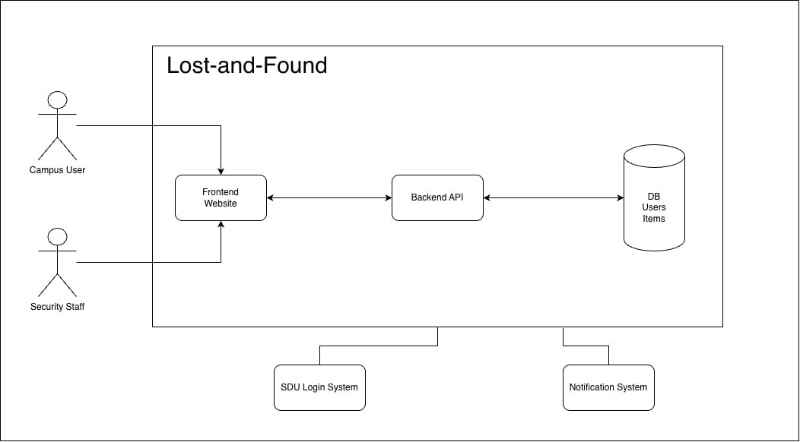

# Campus Lost-and-Found System Architecture

## 1. Architecture Overview

The system uses a Django-based Modular Monolith
Architecture.

## 2. Backend Modules

- accounts: University SSO authentication
- items: Lost and found item management
- matching: Automated item matching
- claims: Ownership verification and handover
- notifications: Email and push notifications

## 3. Database

PostgreSQL is used for persistent data storage.

## 4. External Systems

- University SSO (OAuth2)
- Email and Push Notification Gateway

## 5. Quality Attributes

### Performance
95% of item creation requests must complete
within 2 seconds under 200 concurrent users.

### Fault Tolerance
Core operations must continue during a
15-minute notification service outage.
Notifications are queued for later delivery.

## 6. Architecture Diagram

